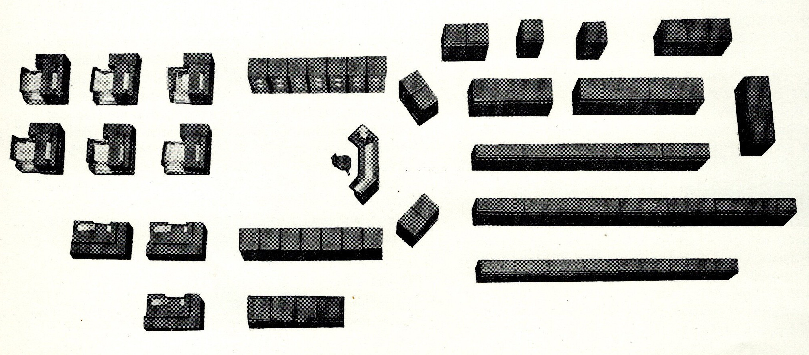

# Bull Gamma 60 — documentation and emulator

*A complete Gamma 60 installation: plan view of the cabinets (scale model).*

## The machine

The **Bull Gamma 60** was a large French computer designed by Compagnie des Machines Bull from
1955 and first delivered in 1960. The last machines were taken out of service in 1974.
Only 16 documented installations were delivered for customers mainly in France (EDF, SNCF...),
Belgium (RTT), Italy and Japan ([docs/HISTORY.md](docs/HISTORY.md)).

It was one of the very first computers designed from the start to perform **several tasks at once**.
Instead of one processor doing everything, it had a set of specialised, autonomous units
(arithmetic, logic, comparison, transcoding, drums, tapes, card readers, printers,...) sharing one
memory, and a central "distributor" unit that only handed out work to them. Its instruction set already
contained what we now call **fork and join**, **wait queues** and **locks**, years before
these ideas were named and became standard.

## What is left of it

- **No machine survives.** A Gamma 60 filled a large room, and few were built.
- **The documentation is partial and scattered**: a few Bull manuals and brochures,
  conference papers, articles and later testimonies, not all of them available online.
- **There was no emulator** that lets one see how the machine actually worked.

## What this project does

1. **Consolidate the documentation**: gather the sources, extract the facts, cite each one,
   and list explicitly what is unknown.
2. **Show what was new at the time**, especially multiprogramming and concurrency, compared
   with the other computers and ideas of its era.
3. **Provide an emulator** built only on the available data. Every assumption and every
   unknown is made **explicit and adjustable** (in [`data/`](data/) and
   [docs/UNKNOWNS.md](docs/UNKNOWNS.md)), so that it can easily be completed or corrected when
   new sources turn up.

The project is also an experiment in **AI-assisted work**: an AI assistant (Claude) helps with
the analysis of the documents and with the code, under human direction and review.

## Current status

All known documentation is currently consolidated inside this repository and also published
on Internet Archive https://archive.org/details/bull-gamma-60

The emulator is still work in progress but is already quite advanced: all core instructions and peripherals
are supported including parallel operation. The whole toolchain is present. The OS layer is in analysis phase.

## More detailed information

The [wiki](wiki/) presents the machine in English:

- [Architecture](wiki/ARCHITECTURE.md) — the elements, the central unit and how they cooperate.
- [Memory](wiki/MEMORY.md) — the core store, the 24-bit word (catena), number formats and the
  memory layout.
- [Concurrency](wiki/CONCURRENCY.md) — fork/join, wait queues and locks on the Gamma 60.
- [Registers](wiki/REGISTERS.md) — the registers of the central unit, of the Program Distributor and of each
  element, with their sizes.
- [Instructions](wiki/INSTRUCTIONS.md) — codes A, B, C, D and every instruction, in English and French forms.
- [Installations](wiki/INSTALLATIONS.md) — the 16 customers, the deployment calendar and photos.
- [Facts and anecdotes](wiki/TRIVIA.md) — the stories around the machine, from its name to *Alphaville*.
- [Command line](wiki/MAN.md) — the `gamma60` man page: running, assembling and observing programs
  (traces, step-by-step debugger, memory dumps, ASCII timelines).
- [References](wiki/REFERENCES.md) — Bull publications, related work and later analyses.
- [AI in this project](wiki/AI.md) — how an AI assistant was used: OCR correction, source study,
  emulator by milestones.

## For contributors

The reference specification is in French in [`docs/`](docs/) (start with
[docs/MACHINE.md](docs/MACHINE.md)); it prevails over the wiki. Source PDFs are in
[`archives/docs/`](archives/docs/), the bibliography in [docs/SOURCES.md](docs/SOURCES.md),
test programs in [`tests/programs/`](tests/programs/). Working rules are in
[CLAUDE.md](CLAUDE.md).
