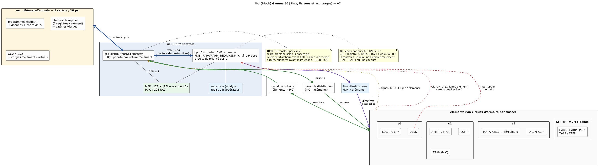
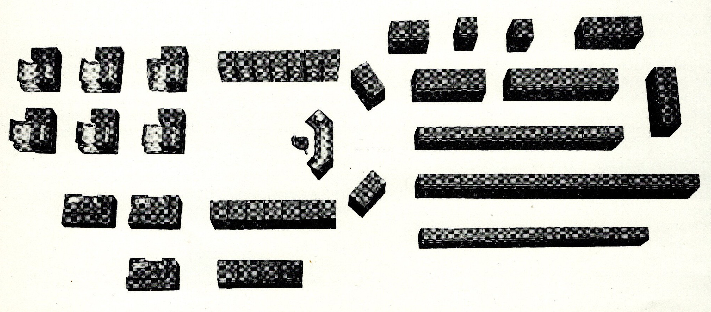
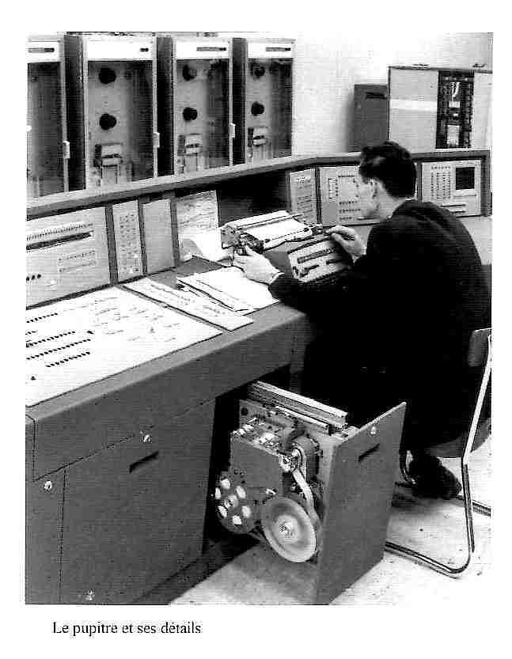
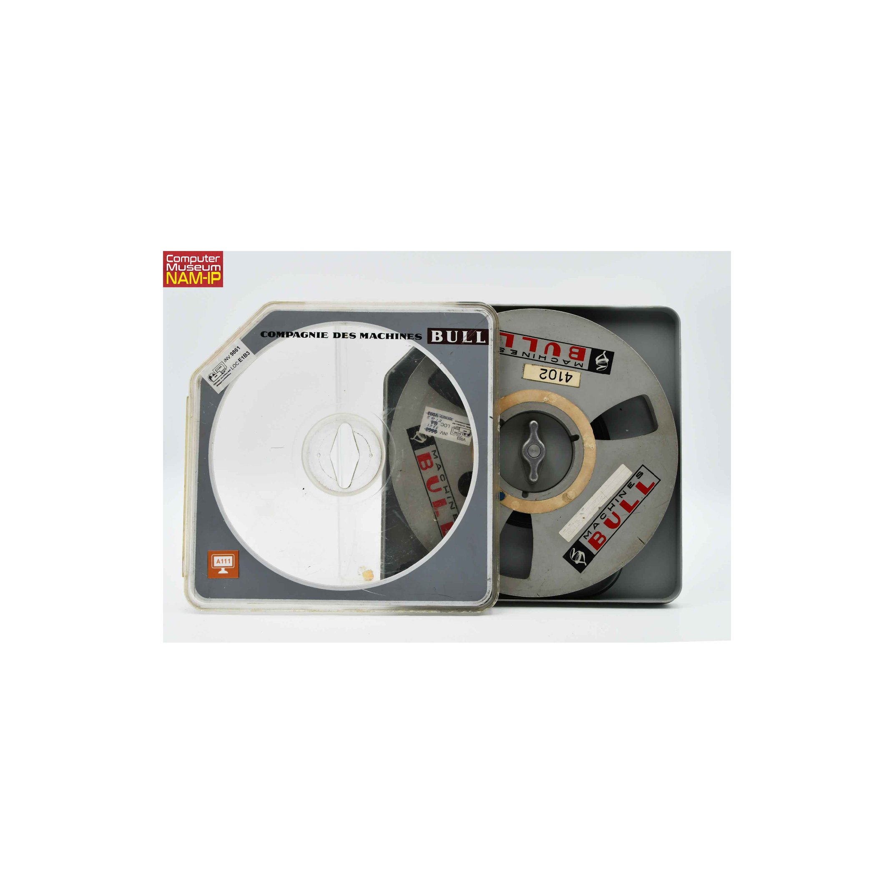
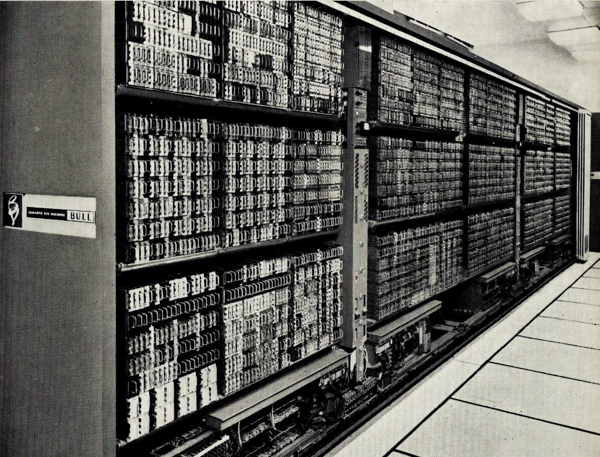
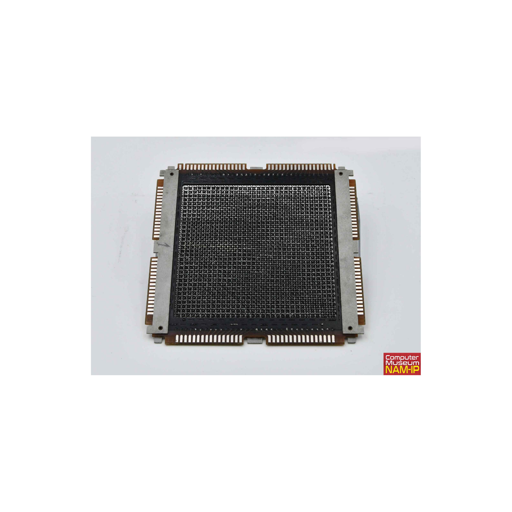

# Architecture of the Gamma 60

> This wiki is an English presentation derived from the reference specification, written in
> French: [`docs/MACHINE.md`](../docs/MACHINE.md) §1, §5-8 and
> [`docs/HARDWARE.md`](../docs/HARDWARE.md) for this page. In case of disagreement, `docs/`
> prevails.

Source keys in square brackets are defined in [`docs/SOURCES.md`](../docs/SOURCES.md). Code B
exists in two languages, `en` (B61) and `fr` (COURS); mnemonics are written **`en` / `fr`**
(see [MEMORY.md](MEMORY.md)).

---

## 1. The big picture: a distributed machine

Most computers of the 1950s are built around one processor that does everything in turn:
it fetches an instruction, computes, waits for a card reader, computes again. The Gamma 60
takes another road. It is a set of **specialized, autonomous units called "elements"**,
grouped around **one shared central memory**. [B61 p.20-21]

- **Every unit is an element.** The arithmetic calculator, the comparator, the drum, the
  tape units, the printer… are all built and connected the same way. Even the calculation
  units are not part of the central unit: they are elements, like the input/output devices.
  [B61 p.20-22]
- **Elements never talk to each other.** They only exchange data with the central memory,
  which acts as the **"meeting place"** (*lieu de rendez-vous*) of the machine. [B61 p.20-21]
- **Elements work in parallel.** Once an element has received its order, it works on its own
  while the others carry on. Several sequences, from one program or from independent
  problems, run at the same time. [B61 p.20]
- **One stored program.** Instructions and data share the same memory and addresses
  (von Neumann machine). [B61 p.8, p.10]

### How the pieces fit together

The **central unit** does not compute: it coordinates. It contains [B61 p.21 ; COURS p.4]:

| Part | Role |
|---|---|
| **Central memory** (MC) | stores programs and data; one catena (24-bit word) in or out per cycle. See [MEMORY.md](MEMORY.md). |
| **Program Distributor** (DP) | reads the instructions and hands them to the elements, one element at a time |
| **Data Distributor** (DT), called *distributeur de quantités* by ONDE | grants access to the memory: one transfer per cycle, chosen by a fixed priority order |
| **Register matrices** | for each element, the address of its next instruction (RAI) and its current data addresses (RAC) |

All elements share common **channels**: a distribution channel (memory → elements), a
collection channel (elements → memory) and an instruction channel. Each element has two
request lines [B61 p.21 ; COURS p.4-8]:
- **DI**, *demande d'instruction*: "I am free, give me my next order";
- **DTQ**, *demande de transfert*: "I need to read or write a catena now".

### A program in motion

1. A program is cut into **sequences**. Each sequence starts with a **cut** (*coupure*) that
   names the element which will execute it, e.g. `ARIT` / `ARIT`. [B61 p.28]
2. When an element raises its DI line, the DP serves it. It reads that element's
   instructions and sends it its next **directive** (`MUL`, `TDC`…). The DP does not serve
   anyone else in between. [B61 p.28 ; COURS p.14-17]
3. The element then works **alone**. It asks the DT for each catena it needs (DTQ), while the
   DP serves other elements. [B61 p.22-24]
4. If an element is busy when a sequence asks for it, the sequence waits in that element's
   **recovery chain** (*chaîne de reprise*), a queue kept in memory. [B61 p.24-25 ;
   COURS p.24-31]
5. `SIMU` / `SIMU` launches two sequences at once (fork); a cut with a join count waits for
   all branches (join). [COURS p.36-37 ; B61 p.25]

An order of magnitude from B61: reading one tape block takes about 50 ms, of which the DP is
busy for only about 100 µs. The rest of the time it serves other elements. [B61 p.24]

### Diagrams

> **TODO (image):** historical block diagram of the Gamma 60 (central memory, DP, DT,
> channels, elements). Candidates: the general diagram in [ONDE] (1st part, §2) or in B61
> (chap. 2). To be extracted as an image into `archives/photos/` and linked here.

SysML model of the same structure (internal block diagram): flows between memory, DT, DP,
channels and element classes.

Block structure (DP and its registers, DT, matrices, channels, elements):
[`gamma60_bdd_structure.png`](../docs/diagrams/gamma60_bdd_structure.png). Model source:
[`docs/diagrams/`](../docs/diagrams/).

*Plan view of the cabinets of a complete installation (scale model). TODO: source and caption
to be documented.*

---

## 2. Anatomy of an element

All elements follow the same pattern; only their complexity differs. [ONDE §3 ; B61 p.22]

- **Processing circuits** do the actual work (add, compare, read a card…).
- **Control circuits** run a **wired program**: a chain of steps that starts from the decoder
  of the received directive. [ONDE §3]
- A one-catena **link register** (RLN) decouples the memory cycle from the element's own
  rhythm. [COURS p.8 ; B61 p.23]
- A **qualitative catena** collects the element's 24 result and incident flags. The DP copies
  it into register A when it serves the element, where conditional branches test it.
  [B61 p.23 ; COURS p.6, p.15]

An element is either **idle** (no sequence) or **active**. An active element is either
**waiting** for its next order (DI line raised) or **operating** on its own. [COURS p.13-14]

Each element understands its own set of **directives**. Some are only **preparatory**: they
pass a parameter, e.g. a drum address or a tape-drive number. Others are **operative**: they
start the actual work. [COURS p.40-42] The full list is in
[INSTRUCTIONS.md](INSTRUCTIONS.md).

---

## 3. The element classes

Elements are grouped into **classes** "according to their performance and to the urgency of
their transfer requests". Each class shares one set of connection circuits to the central
unit (*circuits d'armoire*). [ONDE §2.1, §3]

ONDE announces "4 classes" but describes **five, numbered 0 to 4**:

| Class | Elements | Character |
|---|---|---|
| **0** | control desk, logical calculator (LOGI) | operator interface; simple binary unit |
| **1** | comparator (COMP), transcoder (TRAN), arithmetic calculator (ARIT) | fully electronic processing elements |
| **2** | magnetic drums, uniselectors with their tape units | magnetic auxiliary memories |
| **3** | card readers and punches, printers | slow input/output, through the Multiplexer |
| **4** | paper tape readers and punches, typewriters… | very slow input/output |

[ONDE §2.1, §3 ; docs/MACHINE.md §6.3] There are five sets of connection circuits: one for
class 0, one for class 1, two for class 2, and one shared by classes 3 and 4. [ONDE §2.1]
MAI places LOGI in class 1 instead of 0; the emulator uses class 0 by default (U-09).

The DT priority order follows the urgency of the elements, not their class number. For
instance, the drum must be served before ARIT, or a whole revolution of 20 ms is lost.
[B61 p.23-24] The exact order is a hypothesis (U-03, `data/priorities.yaml`).

**Sharing.** Processing elements and drums are **shared**: any sequence can call them and
waits in their recovery chain. Tape units, card units, printers and paper tape units are
**attributed** to one program, accept one operation per call, and protect their memory zone
with a **virtual element** (`PROT` / `PROT`, `LIBE` / `LIBE`). [AVG p.59 ; B61 p.42]

---

## 4. The elements, class by class

Each entry gives the element's **function**, the **kinds of instructions** it executes and
its **hardware**. Mnemonics: cut name `en` / `fr`.

### Class 0

#### Control desk — `DESK` / *fr not recorded* (U-29)
- **Function:** the operator's station. It starts programs when the elements and the memory
  zone they need are free, logs the run on paper tape, and allows step-by-step execution
  (per cycle, per instruction) and stop on address. It is the only source of priority
  interrupts. [B61 p.47-48 ; ONDE ; MAI]
- **Instructions:** typewriter input and output for the operator. B61 also says the desk is
  "not an I/O element", although a `DESK` cut exists (U-27).
- **Hardware:** a typewriter (10 characters/s), a paper tape reader and punch, keyboards,
  and 8 × 8 lights showing the state of 8 programs. [ONDE §3.1 ; B61 p.47-48 ; MAI]

*The desk with its typewriter and, below, the paper tape unit. TODO: source of the photo to be
documented.*

#### Logical calculator — `LOGI` / `LOGI`
- **Function:** the four arithmetic operations in **pure binary**, and logical operations on
  24-bit words: union, intersection, shifts, complement. [ONDE §3.1 ; B61 p.39-40]
- **Instructions:** loading with shift (`TSK` / `TCK`, `TSL` / `TCL`), shifts, fill,
  add, subtract, multiply, divide, logical operations (`INT` / `INT`, `REU` / `REU`),
  comparison (`BLC` / `CNL`). [B61 p.39-40 ; COURS p.111-121]
- **Hardware:** two 24-bit shift registers, K and L, the result going to L; 4 RAC. It works
  **serially**, which "leads to a very simple operator". [ONDE §3.1 ; B61 p.39-40]

> **TODO (image):** LOGI cabinet or logic board.

### Class 1

#### Comparator — `COMP` / `COMP`
- **Function:** sorting and merging. It compares zones of 1 to 255 catenae, in pure binary,
  most significant bits first, without sign or exponent: two zones together, or one zone
  against two bounds. It also copies one memory zone to another and erases zones.
  [ONDE §3.2 ; B61 p.36-37]
- **Instructions:** simple comparison (`OWC` / `CMP`), comparison with two bounds
  (`TWC` / `CDB`), erase (`DEL` / `EFL`), memory-to-memory transfer (`TSS` / `TRR`).
- **Hardware:** two operand registers and a length register; 3 specialized RAC; works **in
  parallel**. [ONDE §3.2 ; B61 p.36-37]

> **TODO (image):** comparator.

#### Transcoder — `TRAN` / `TRAD`
- **Function:** converts data between external codes (Bull and IBM cards, paper tape,
  printer) and the internal code; lays out, condenses and expands data; transposes card
  rows into columns; builds semi-logarithmic numbers. [B61 p.37-39 ; ONDE §3.2]
- **Instructions:** phase directives (cards → processing form, processing form → printer…),
  then `RCL` to start its own small program of **clichés**, short instructions it fetches
  from memory on its own, without the DP. [B61 p.37-39 ; ONDE §3.2]
- **Hardware:** six sub-assemblies that behave like independent elements, each with its own
  transfer requests. Two **core matrices** (transposition, and code interpretation MIC
  loaded by program with the wanted code table), input and output registers with their
  counters, and the directive and cliché interpreters. [ONDE §3.2] MIC size: 256 [B61],
  128 × 20 bits [COURS] or 128 × 21 bits [ONDE] (U-12).

> **TODO (image):** transcoder or its MIC core plane.

#### Arithmetic calculator — `ARIT` / `ARIT`
- **Function:** decimal arithmetic on semi-logarithmic numbers (floating or fixed point),
  checked by remainder mod 7. [B61 p.35-36 ; ONDE §3.2] Number format: see
  [MEMORY.md](MEMORY.md) §2.3.
- **Instructions:** 13 directives: add, subtract, multiply, divide, transfer, multiply or
  divide by a power of ten, sign, absolute value, comparisons, round off (`ROF` / `ARR`).
  [B61 p.35-36 ; COURS p.61-72]
- **Hardware:** registers P (main), S (secondary) and O, 2 catenae each; P + S form a
  20-digit accumulator. A large **parallel adder** with repetitive circuits. An original
  multiplier keeps the ×2 and ×5 multiples of the multiplicand and splits each multiplier
  digit into factors (1, 2, 2 × 2, 5), so each digit costs at most 3 additions; division uses
  the same operators. [ONDE §3.2 ; B61 p.35-36] Times: 200 / 350 / 550 µs for add / multiply
  / divide [B61], 100 / 300 / 600 µs [COURS].

> **TODO (image):** arithmetic calculator.

### Class 2

#### Magnetic drum — `DRUM` / `TAMB`
- **Function:** fast auxiliary memory, addressable by catena, shared between programs.
  [B61 p.12 ; ONDE §3.3]
- **Instructions:** set the drum address (`DAO` / `DAO`, preparatory), then transfer memory
  → drum (`TCD`) or drum → memory (`TDC`). [B61 p.53 ; COURS p.152-154]
- **Hardware:** 128 tracks of 200 addressable catenae (204 physical); 2,975 rpm according to
  ONDE (3,000 elsewhere), i.e. 20 ms per turn and 10 ms average access; 100 µs per catena
  [B61] or 98 µs [COURS]. Up to 4 drums with common selection logic. [B61 p.12 ;
  ONDE §3.3 ; HARDWARE.md]

> **TODO (image):** magnetic drum.

#### Uniselectors and tape units — `MATA` / `DERU`
- **Function:** mass storage on magnetic tape. The element is the **uniselector**, which
  connects to one tape unit at a time. [B61 p.13, p.53-55]
- **Instructions:** preparatory (write, read forward, read backward, with the drive number),
  execution (transfer, skip, erase, write tape mark) and service (rewind, operator request).
  [B61 p.53-55 ; COURS p.137-151]
- **Hardware:** up to 10 uniselectors, each reaching up to 12 tape units, 48 units in all; a
  unit can be reached by 2 or 3 uniselectors. Mylar tape 12.7 mm wide, 8 tracks (6 data, 1
  key, 1 parity), phase modulation, 1.90 m/s, vacuum columns, start-stop about 1 ms. Blocks of
  16 to 4,095 catenae; reels of 730 m or 1,100 m. [B61 p.13, p.26, p.53-55 ; ONDE §3.3 ;
  HARDWARE.md]

*Bull magnetic tape reel in its case (NAM-IP collection).*

> **TODO (image):** tape units and uniselector cabinet.

### Class 3

All class 3 elements reach the central unit through the **Multiplexer**. It interleaves the
catenae of these slow elements on the channel. [ONDE §3.4]

#### Card reader and card reader-punch — `CARR` / `LECT`, `CARP` / `PECT`
- **Function:** reading and punching 80-column cards. [B61 p.42-43]
- **Instructions:** read, punch, choose the output stacker, clear the track, operator requests
  (end of file, incident). [B61 p.42-43]
- **Hardware:** 300 cards/min; feed hopper of 3,000 cards; double reading stations for
  checking; punch check. [B61 p.42-43]

> **TODO (image):** card reader-punch.

#### Printer — `PRIN` / `IMPR`
- **Function:** line printing on two independent paper feeds. [B61 p.45-47]
- **Instructions:** skip on the 2nd paper, skip and print on the 1st paper, operator requests.
- **Hardware:** 120 print positions, 59 characters, 300 lines/min, rotating character drum.
  A one-line core memory checks every strike by comparing, column by column, the drum position
  with the stored character code. [B61 p.45-47 ; ONDE §3.4]

> **TODO (image):** printer.

### Class 4

#### Paper tape reader and punch — `TAPR` / `LEBA`, `TAPP` / `PEBA`
- **Function:** input and output on 5- or 8-track paper tape. [B61 p.43-45]
- **Instructions:** read or punch a number of catenae; operator requests.
- **Hardware:** photoelectric reader at 300 characters/s, both directions, 3 characters per
  catena; punch at 25 characters/s, unchecked. [B61 p.43-45] ONDE also announces
  typewriters, teleprinters, mark-sensed cards and magnetic character readers for this class.
  [ONDE §3.5]

> **TODO (image):** paper tape reader.

---

## 5. Technology in a few words

Germanium transistors and two-layer germanium diode logic; about 3,600 "sections" of 4
amplifiers; a few vacuum tubes in the central unit only. Clock of 5 phases at 200 kHz, giving a
10 µs cycle. Logic is built from plug-in boxes, grouped into sections, cells and cabinets of 6
or 9 cells. [ONDE ; B61 p.4-5] Details in [`docs/HARDWARE.md`](../docs/HARDWARE.md).

*Logic cabinets of the Gamma 60. TODO: source and caption to be documented.*

*A ferrite-core plane (NAM-IP collection). Core planes are used both for the central memory
and for the register matrices (RAI, RAC), the MIC and the transposition matrix. [ONDE]*

---

## 6. In the emulator

Each element is a state machine (idle, waiting for an instruction, served, executing) that
talks only to the two arbiters: the DP for instructions and the DT for transfers. Element
counts per installation are in [`data/configs/`](../data/configs/), classes and priorities in
[`data/priorities.yaml`](../data/priorities.yaml), directives in
[`data/directives.yaml`](../data/directives.yaml). Planned modules:
[`docs/EMULATOR_DESIGN.md`](../docs/EMULATOR_DESIGN.md).

See also [CONCURRENCY.md](CONCURRENCY.md): cuts, `SIMU` / join, recall chains, virtual elements.
