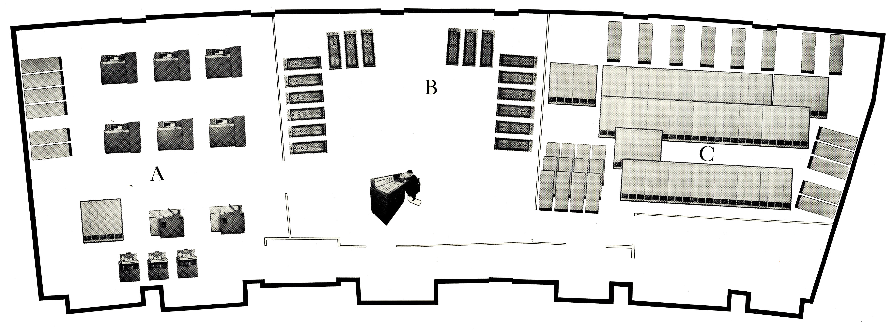
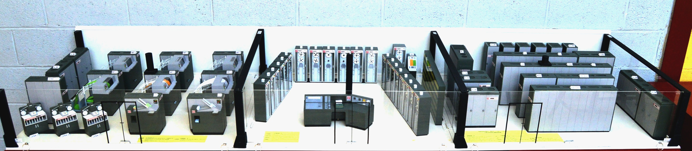

# Known installations

Where the Gamma 60 machines ran. Derived from [`docs/HISTORY.md`](../docs/HISTORY.md)
("Installations clients"), which prevails.

> **About the dates.** Most dates are **read off a chart** ("Calendrier des installations
> clients", §2), to about half a year. The chart's origin is still to be documented (probably
> *L'Aventure Gamma 60* [AVG], which lists 16 machines). Customer names are given as written
> on the chart; their expansions are not yet sourced.

See also [ARCHITECTURE.md](ARCHITECTURE.md), [REFERENCES.md](REFERENCES.md).

---

## 1. Customers in chronological order

Ordered by date of order. *Available* = put into service; *Returned* = decommissioned.

| # | Customer | Country | Ordered | Delivered | Available | Returned |
|---|---|---|---|---|---|---|
| 1 | AGVie | — | 1957 | — | 1960 | 1962 |
| 2 | EDF | France | 1957 | 1960 | 1960 | 1964 |
| 3 | CNEP | — | 1957 | 1961 | 1962 | 1969 |
| 4 | UNION I | — | 1957 | 1961 | 1963 | 1969 |
| 5 | SNCF | France | 1958 | 1960 | 1960 | 1966 |
| 6 | RTT I | Belgium | 1958 | 1960 | 1961 | 1974 |
| 7 | URBAINE SEINE | — | 1959 | 1961 | 1961 | 1970 |
| 8 | GMF | — | 1960 | 1962 | 1962 | 1973 |
| 9 | CREDITO ITALIANO | — | 1960 | 1961 | 1961 | unknown (≈ 1971?) |
| 10 | CEA | — | 1960 | 1961 | 1962 | 1964 |
| 11 | BANCA LAVORO | Italy | unknown | 1962 | 1963 | unknown (≈ 1971?) |
| 12 | PRINTEMPS | — | 1961 | — | 1962 | 1965 |
| 13 | HBNPC | — | 1961 | 1962 | 1963 | 1970 |
| 14 | TLF | — | 1962 | 1963 | 1964 | 1972 |
| 15 | MITSUBISHI | — | 1963 | 1965 | 1965 | 1972 |
| 16 | RTT II | Belgium | 1964 | — | 1966 | 1974 |

"—": not shown or not sourced yet. No order is shown as cancelled; the last two machines (RTT I
and II) left service in 1974 [RTT].

## 2. Deployment calendar

*"Calendrier des installations clients": for each customer, order (dot), delivery (arrow),
availability (start of the thick line) and return (end). Dashed: dates unknown. TODO: source
to be documented.*

## 3. Customers

### AGVie
- **Dates**: ordered 1957 (AVG associates the date 26 June 1957 with AGVie), available 1960,
  returned 1962.
- TODO: country, company, processing, photo.

### EDF
- **Country**: France (Paris).
- **Dates**: ordered 1957; **first Gamma 60 delivered**, 1960 [FEB]; returned 1964.
- TODO: processing, photo.

### CNEP
- **Dates**: ordered 1957, available 1962, returned 1969.
- TODO: country, company, processing, photo.

### UNION I
- **Dates**: ordered 1957, available 1963, returned 1969.
- TODO: country, company, processing, photo.

### SNCF
- **Country**: France; computer room at the **Gare d'Auteuil**, Paris.
- **Company**: the French national railways; chose the Gamma 60 in 1957 [FEB].
- **Processing**: **payroll**, in service from 15 April 1961 [FEB].
- **Dates**: delivered November 1960 [FEB], returned 1966.

*View of the Gamma 60 room at the Gare d'Auteuil (original caption).*

*The same installation (attribution from the file name; TODO: source).*

### RTT I
- **Country**: Belgium (Brussels, rue Lebeau).
- **Company**: the "Régie des T.T." [La Meuse] (RTT).
- **Processing**: **telephone billing**: preparing and collecting the accounts of about
  600,000 telephone subscribers, for 850,000 calls a month. The press called it the most
  powerful electronic installation in Belgium, inaugurated by the minister of P.T.T.
  M. Busieau. [*La Meuse*, 6 July 1961]
- **Dates**: contract December 1958 [RTT], available 1961, in service until **1974**, the
  last Gamma 60 in operation [RTT].

*"Gamma 60, the most powerful electronic installation in Belgium, at the service of the
Brussels T.T.", La Meuse, 6 July 1961.*

*Plan view of the installation, with zones A, B and C (attribution to RTT from the file name;
TODO: source).*

*Scale model (NAM-IP, according to the file name; TODO: source).*

### URBAINE SEINE
- **Dates**: ordered 1959, available 1961, returned 1970.
- TODO: country, company, processing, photo.

### GMF
- **Dates**: ordered 1960, available 1962, returned 1973.
- TODO: country, company, processing, photo.

### CREDITO ITALIANO
- **Dates**: ordered 1960, available 1961; return date unknown.
- TODO: country, company, processing, photo.

### CEA
- **Dates**: ordered 1960, available 1962, returned 1964.
- TODO: country, company, processing, photo.

### BANCA LAVORO
- **Country**: Italy (Rome).
- **Dates**: order date unknown, available 1963; return date unknown.
- TODO: company, processing.

*Left: an open cabinet. Right: "Installation at the Banca del Lavoro in Rome" (original
captions).*

### PRINTEMPS
- **Dates**: ordered 1961, available 1962, returned 1965.
- TODO: country, company, processing, photo.

### HBNPC
- **Dates**: ordered 1961, available 1963, returned 1970.
- TODO: country, company, processing, photo.

### TLF
- **Dates**: ordered 1962, available 1964, returned 1972.
- TODO: country, company, processing, photo.

### MITSUBISHI
- **Dates**: ordered 1963, available 1965, returned 1972.
- TODO: country, company, processing, photo.

### RTT II
- **Country**: Belgium. Second machine of the RTT (see RTT I).
- **Dates**: ordered 1964, available 1966, in service until 1974.
- TODO: processing, photo.
