# Known installations

Where the Gamma 60 machines ran. Derived from [`docs/HISTORY.md`](../docs/HISTORY.md)
("Installations clients"), which prevails.

> **About the dates.** Most dates are **read off a chart** ("Calendrier des installations
> clients", §2), to about half a year. The chart's origin is still to be documented (probably
> *L'Aventure Gamma 60* [AVG], which lists 16 machines). Customer names are given as written
> on the chart; full names and locations come from the FEB customer page [FEB-CLI].

See also [ARCHITECTURE.md](ARCHITECTURE.md), [REFERENCES.md](REFERENCES.md).

---

## 1. Customers in chronological order

Ordered by date of order. *Available* = put into service; *End of life* = taken out of
service. Years read off the calendar (§2) unless stated; full names and locations from the FEB
customer page [FEB-CLI]. "France (deduced)": FEB-CLI spreads its customers over France, Italy,
Belgium and Japan and names those of the last three countries. *Use*: what the machine
processed, when a source says so.

| # | Customer | Full name | Location | Ordered | Delivered | Available | End of life | Use |
|---|---|---|---|---|---|---|---|---|
| 1 | AGVie | — (not on FEB-CLI) | — | 1957 | — | 1960 | 1962 | — |
| 2 | EDF | EDF Études et Recherches | Paris, place des États-Unis | 1957 | 1960 | 1960 | 1964 | — |
| 3 | CNEP | Comptoir National d'Escompte de Paris | France (deduced) | 1957 | 1961 | 1962 | 1969 | — |
| 4 | UNION I | L'Union | France (deduced) | 1957 | 1961 | 1963 | 1969 | — |
| 5 | SNCF | SNCF (French national railways) | Paris, Gare d'Auteuil | 1958 | 1960 | 1960 | 1966 | staff management: payroll of about 300,000 employees, pensions, freight traffic [FEB ; FEB-SNCF ; LEC] |
| 6 | RTT I | Régie des Télégraphes et Téléphones | Brussels, Belgium | 1958 | 1960 | 1961 | 1974 | telephone billing: about 600,000 subscribers [*La Meuse*] |
| 7 | URBAINE SEINE | L'Urbaine et la Seine | France (deduced) | 1959 | 1961 | 1961 | 1970 (?) | — |
| 8 | GMF | Garantie Mutuelle des Fonctionnaires | France (deduced) | 1960 | 1962 | 1962 | 1973 | insurance: contract file updates (policies, amendments, renewal notices), then accounting and claims [FEB-GMF] |
| 9 | CREDITO ITALIANO | Credito Italiano (sold by Olivetti-Bull) | Milan, Italy | 1960 | 1961 | 1961 | unknown (≈ 1971?) | — |
| 10 | CEA | Commissariat à l'Énergie Atomique, CEA/DAM | Vaujours, France | 1960 | 1961 | 1962 | 1964 | — |
| 11 | BANCA LAVORO | Banca Nazionale del Lavoro | Rome, Italy | unknown | 1962 | 1963 | unknown (≈ 1971?) | — |
| 12 | PRINTEMPS | Le Printemps | Paris, France | 1961 | — | 1962 | 1965 | — |
| 13 | HBNPC | Houillères du Bassin du Nord et du Pas-de-Calais | Douai, France | 1961 | 1962 | 1963 | 1970 | — |
| 14 | TLF | CNRS, Trésor de la Langue Française | Nancy, France | 1962 | 1963 | 1964 | 1972 (end of 1971 per FEB-TLF) | lexicography: text indexing and concordances for the TLF dictionary, about 100,000 words a day [FEB-TLF] |
| 15 | MITSUBISHI | Mitsubishi Shoji Kaisha | Tokyo, Japan | 1963 | 1965 | 1965 | 1972 | — |
| 16 | RTT II | Régie des Télégraphes et Téléphones | Brussels, Belgium | 1964 | — | 1966 | 1974 | — |

"—": not shown or not sourced yet. No order is shown as cancelled; the last two machines (RTT I
and II) left service in 1974 [RTT ; FEB-CLI]. The FEB page lists 14 customers and 15 machines and
does not mention AGVie. The FEB page confirms several calendar years (SNCF, Credito Italiano,
URBAINE, RTT, CEA, PRINTEMPS, BANCA LAVORO, MITSUBISHI); its sources are in
[`docs/HISTORY.md`](../docs/HISTORY.md).

## 2. Deployment calendar

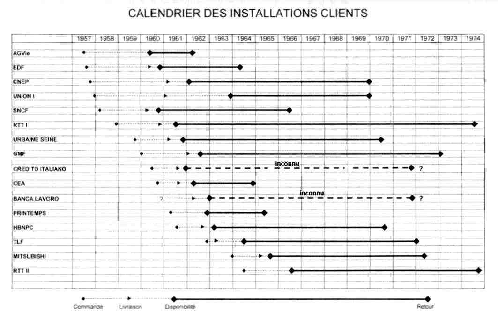

*"Calendrier des installations clients": for each customer, order (dot), delivery (arrow),
availability (start of the thick line) and return (end). Dashed: dates unknown. TODO: source
to be documented.*

## 3. Customers

### AGVie
- **Dates**: ordered 1957 (AVG associates the date 26 June 1957 with AGVie), available 1960,
  returned 1962.
- TODO: country, company, processing, photo.

### EDF
- **Country**: France (Paris).
- **Dates**: ordered 1957; **first Gamma 60 delivered**, 1960 [FEB]; returned 1964.
- TODO: processing, photo.

### CNEP
- **Dates**: ordered 1957, available 1962, returned 1969.
- TODO: country, company, processing, photo.

### UNION I
- **Dates**: ordered 1957, available 1963, returned 1969.
- TODO: country, company, processing, photo.

### SNCF
- **Country**: France; computer room at the **Gare d'Auteuil**, Paris.
- **Company**: the French national railways; chose the Gamma 60 in 1957 [FEB].
- **Processing**: **payroll**, in service from 15 April 1961 [FEB].
- **Dates**: delivered November 1960 [FEB], returned 1966.

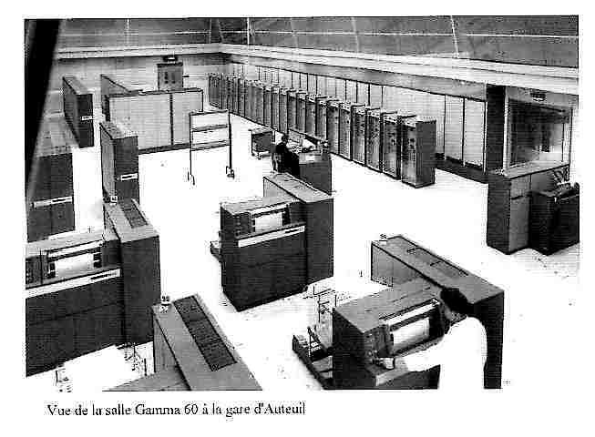

*View of the Gamma 60 room at the Gare d'Auteuil (original caption).*

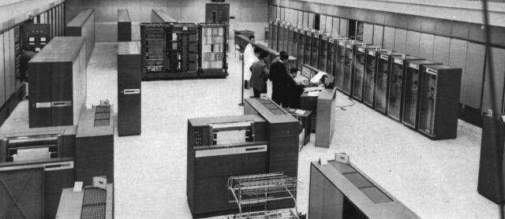

*The same installation (attribution from the file name; TODO: source).*

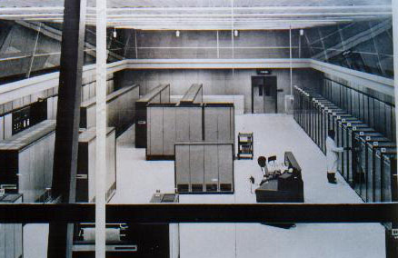

*General view of the Gamma 60 room of the SNCF, shown under the SNCF entry of the FEB customer page [FEB-CLI].*

### RTT I
- **Country**: Belgium (Brussels, rue Lebeau).
- **Company**: the "Régie des T.T." [La Meuse] (RTT).
- **Processing**: **telephone billing**: preparing and collecting the accounts of about
  600,000 telephone subscribers, for 850,000 calls a month. The press called it the most
  powerful electronic installation in Belgium, inaugurated by the minister of P.T.T.
  M. Busieau. [*La Meuse*, 6 July 1961]
- **Dates**: contract December 1958 [RTT], available 1961, in service until **1974**, the
  last Gamma 60 in operation [RTT].

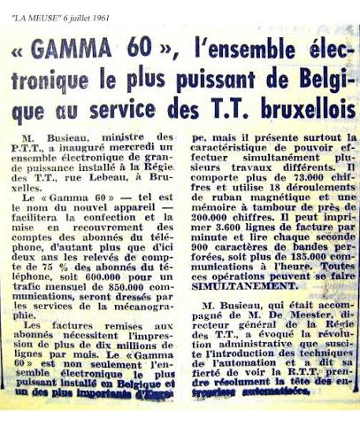

*"Gamma 60, the most powerful electronic installation in Belgium, at the service of the
Brussels T.T.", La Meuse, 6 July 1961.*

*Plan view of the installation, with zones A, B and C (attribution to RTT from the file name;
TODO: source).*

*Scale model (NAM-IP, according to the file name; TODO: source).*

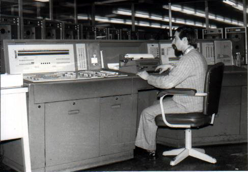

*"Gamma 60 of the RTT. The desk can be seen; one of its drawers holds a paper tape reader, and the rows of magnetic tape drives are in the background" (original caption, © G. Natan) [FEB-CLI].*

### URBAINE SEINE
- **Dates**: ordered 1959, available 1961, returned 1970.
- TODO: country, company, processing, photo.

### GMF
- **Dates**: ordered 1960, available 1962, returned 1973.
- TODO: country, company, processing.

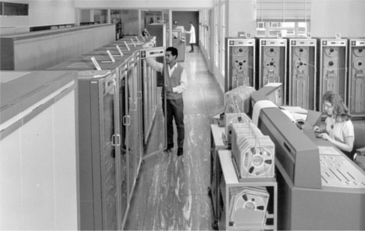

*Gamma 60 room of the GMF: cabinets on the left, tape drives at the back, an operator at the desk; shown under the GMF entry of the FEB customer page [FEB-CLI].*

### CREDITO ITALIANO
- **Dates**: ordered 1960, available 1961; return date unknown.
- TODO: country, company, processing.

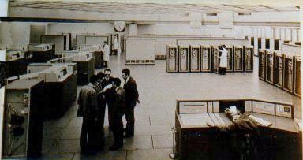

*Gamma 60 room of the Credito Italiano, Milan; shown under its entry of the FEB customer page, file name `g60_credito_natan.jpg` there [FEB-CLI].*

### CEA
- **Dates**: ordered 1960, available 1962, returned 1964.
- TODO: country, company, processing, photo.

### BANCA LAVORO
- **Country**: Italy (Rome).
- **Dates**: order date unknown, available 1963; return date unknown.
- TODO: company, processing.

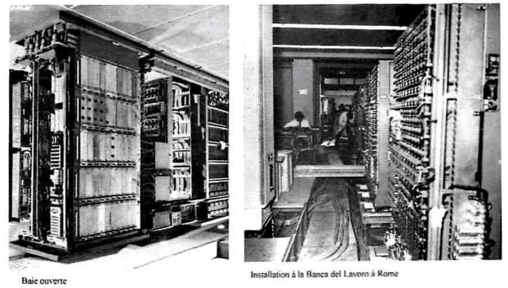

*Left: an open cabinet. Right: "Installation at the Banca del Lavoro in Rome" (original
captions).*

### PRINTEMPS
- **Dates**: ordered 1961, available 1962, returned 1965.
- TODO: country, company, processing, photo.

### HBNPC
- **Dates**: ordered 1961, available 1963, returned 1970.
- TODO: country, company, processing.

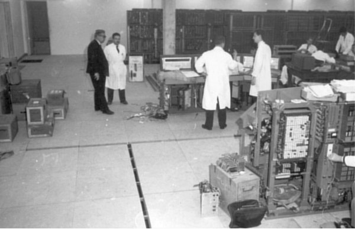

*Gamma 60 of the HBNPC, Douai, apparently during installation or maintenance (open cabinets, technicians); shown under the HBNPC entry of the FEB customer page [FEB-CLI].*

### TLF
- **Dates**: ordered 1962, available 1964, returned 1972.
- TODO: country, company, processing, photo.

### MITSUBISHI
- **Dates**: ordered 1963, available 1965, returned 1972.
- TODO: country, company, processing.

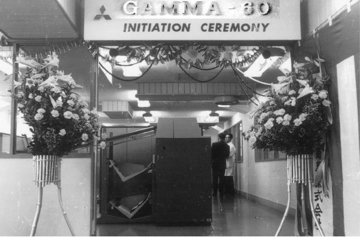

*"GAMMA 60 INITIATION CEREMONY" at Mitsubishi, Tokyo; "inauguration du Gamma 60 de Mitsubishi" (caption of the FEB customer page) [FEB-CLI].*

### RTT II
- **Country**: Belgium. Second machine of the RTT (see RTT I).
- **Dates**: ordered 1964, available 1966, in service until 1974.
- TODO: processing, photo.
